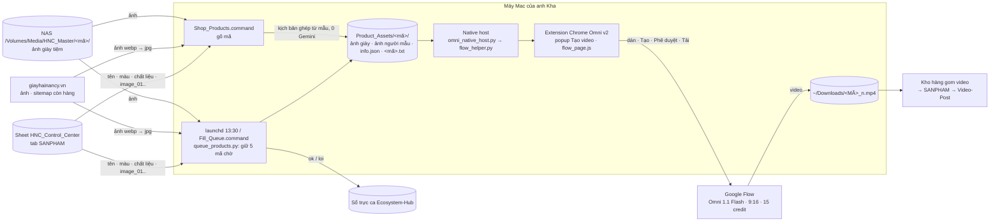

# Kiến trúc & quy trình — Omni-Video
Cập nhật 1/11/2026 (Thực thi · Video AI). **Nguồn duy nhất** tả quy trình / kiến trúc: đổi cấu trúc thì sửa file này (cả sơ đồ) trong cùng commit. Luật: `CLAUDE.md`. Cài đặt: `README.md`.

**Video AI chỉ làm hàng tiệm Hiệu giày Hải Nancy.** Đường Shopee tiếp thị liên kết (Alt+S, nhập CSV, kịch bản Gemini, chuyển NAS) **tạm cất 1/11/2026**, chưa xoá: `archive/README.md` ghi cách lấy lại. Tab `src_omni` để nguyên (Video-Post vẫn đọc video cũ).

## Sơ đồ tổng thể

## Quy trình (hàng tiệm)
| Bước | Anh làm | Script | Kết quả |
|---|---|---|---|
| H0 | Không cần làm: launchd `vn.giayhainancy.omni.queue_products` chạy 13:30 hằng ngày. Bấm tay khi cần: `Fill_Queue.command` (cùng việc, không ghi sổ trực ca) | `queue_products.py` | Dọn mã HNC đã gom, rồi bù cho đủ **5 mã chờ** (chỉ tính mã máy tạo, `info.json` `hang_cho: true`). Lấy từ SANPHAM, **dòng dưới cùng trở lên** (mã mới ở cuối tab). Mã chưa có video trước; hết thì lấy mã đã có video (ít video trước, tối đa 3 / mã, mỗi lần 1 tổ hợp kiểu × bối cảnh chưa dùng). Điều kiện: còn hàng trên web (trang SP có trong `sitemap.xml`, `availability` = InStock), tên có loại giày, có màu, có ảnh. Sổ `data/.queue_products_ledger.json`. Ổ Media không cắm / Downloads không đọc được / Sheet hay web lỗi → không làm gì. Nhật ký `data/logs/queue_products.log`; lịch chạy `--log-health` → ghi 1 dòng sổ trực ca (`log_health.sh omni.queue_products ok\|loi "<ghi chú>"`) |
| H1 | `Shop_Products.command` → gõ mã (vd `JH8918N 32837D`). Enter = kiểu liền; `4` = 4 cảnh; gõ tên kiểu (vd `ngoi_dung`) = chọn tay | `shop_products.py` | `Product_Assets/<mã>/`: ảnh giày theo thứ tự NAS `HNC_Master/<mã>/` → web `giayhainancy.vn/img/<mã>/<n>-1000.webp` → `image_01…` SANPHAM; `info.json` (`hang_tiem: true`, tên / màu / chất liệu / giới tính từ SANPHAM). Kịch bản `<mã>.txt` **ghép từ mẫu `config/shop_products.json`, 0 Gemini**: 1 câu tiếng Việt theo kiểu chuyển động (`tu_nhien`, `san_pham`, `ngoi_dung`; bản chữ đã chốt, không sửa khi anh chưa duyệt) + bối cảnh xoay vòng theo loại giày (chỉ số lưu `data/.shop_products_scene_state.json`). Ảnh dán: tối đa 6 ảnh giày đủ góc (thẳng → chéo 3/4 → góc khác → đế) rồi **ảnh chuẩn người mẫu** `characters/standard/<tên>_<loại>.jpg` theo kiểu (`lien.anh_chuan`). Tên video đặt sẵn `info.json` `ten_video` = `<MÃ>_n.mp4` (n = số video mã đang có ở NAS + Downloads, +1). **Không tạo dòng `src_omni`** |
| H2 | Mở dự án Flow (ô câu lệnh trống) → extension → **Tạo video** ở 1 mã | `flow_page.js` + `flow_helper.py` | Dán ảnh + kịch bản → Tạo → Phê duyệt → chờ video mới (15 phút; Flow báo "hàng chờ xử lý" thì 30 phút). Chống nhầm, phải đủ cả 3: nút "Mở video trong trình chỉnh sửa" mới sau "Phê duyệt" cuối khung chat (id ảnh khác lúc bấm Tạo, số nút tăng); ô lưới cùng id `/asb/`; ≥ 60 giây sau Phê duyệt. Tải: rê chuột ô đó → ⋮ → Tải xuống → 720p (dự phòng: nút chat → trình chỉnh sửa → "Tải nội dung nghe nhìn xuống"); mỗi bước tự bấm lại tới khi Chrome bắt đầu tải. Video **để nguyên** `~/Downloads/<MÃ>_n.mp4`; native host ghi `da_tai` vào `info.json` (mã biến khỏi popup) và chép kịch bản vào `data/made_scripts/<tên video>.txt` (kèm kiểu, bối cảnh, ảnh người mẫu). Lỡ không tải: nút **⬇ Tải lại video** trên khung nổi |
| H3 | Không cần làm | Kho hàng (HNC) | Gom video từ Downloads vào SANPHAM → Video-Post. Lần chạy sau của H0 / H1 thấy video đã rời Downloads thì xoá `Product_Assets/<mã>/` (`shop_products.cleanup`) |

## Đọc / ghi gì
| Nơi | Đọc | Ghi | Ai |
|---|---|---|---|
| Sheet HNC_Control_Center tab `SANPHAM` (Kho hàng giữ; tiêu đề hàng 2) | ✔ theo tên cột | ✘ | `shop_products.py`, `queue_products.py` |
| NAS `/Volumes/Media/HNC_Master/<mã>/` | ✔ chỉ ảnh, đếm video | ✘ | `shop_products.py` |
| Web `giayhainancy.vn` (ảnh, `sitemap.xml`, trang SP) | ✔ | ✘ | `shop_products.py`, `queue_products.py` |
| `Product_Assets/<mã>/` (không commit) | ✔ | ✔ | mọi bước |
| `~/Downloads` | video Flow | tên video `<MÃ>_n.mp4` | extension, native host |
| `config/shop_products.json` | ✔ | ✘ | mẫu kịch bản, bối cảnh, ảnh chuẩn |
| `characters/standard/` (không commit) | ✔ | ✘ | ảnh chuẩn người mẫu |
| `data/` (không commit) | ✔ | ✔ | sổ hàng chờ, chỉ số bối cảnh, `made_scripts/`, `logs/` (cả ảnh chụp trang Flow `flow_snapshot_*.json` để dò lỗi) |
| Sổ trực ca `~/Library/Logs/he_thong/so_truc_ca.tsv` | ✘ | ✔ 1 dòng / lần chạy 13:30 | `queue_products.py --log-health` |
| Sheet Video-Post tab `src_omni` | — | — | Không đụng từ 1/11 (đường Shopee đã cất); Video-Post vẫn đọc dòng cũ |

## Khoá & bí mật (chỉ tên)
| Tên | Ở đâu | Dùng cho |
|---|---|---|
| `config/service_account.json` | file, không commit | Đọc Sheet SANPHAM |
| `GEMINI_OMNI_API_KEY`, `GEMINI_API_KEY` | `.env` (qua `scripts/omni_env.py`) | Hàng tiệm không gọi Gemini; chỉ đường Shopee đã cất dùng |
| Đăng nhập Google Flow | Chrome của anh | Extension dùng phiên sẵn có |

## Nối với project khác
- **Kho hàng (HNC_Master):** gom video `<MÃ>_n.mp4` từ Downloads. Cách đặt số `_n` đang lặp ở `shop_products` (tên đặt sẵn) và HNC `main.py` (gom); đổi cách đặt tên phải sửa cả 2.
- **Ecosystem-Hub:** sổ trực ca (`log_health.sh`, mã `omni.queue_products`).
- **Video-Post:** chỉ còn đọc dòng `src_omni` cũ; chặn kênh Shopee cho `src_omni`.

## Chỗ hay nhầm
- Ô câu lệnh Flow phải trống trước khi bấm; Flow giữ nút / video của phiên cũ, extension chỉ nhận cái mới sau khi bấm Tạo.
- Sửa code extension (thư mục `chrome-extension/`, nạp kiểu Load unpacked) xong phải **Reload** ở `chrome://extensions` và tải lại trang Flow; Chrome không tự cập nhật bản nạp tay.
- Tải tay từ Flow thì phải tự đặt đúng tên `<MÃ>_n.mp4` (popup hiện tên) và báo đã tải.
- Phần đã lưu trữ (đường Shopee, video API, QA Gemini, Spark Drive): `archive/README.md`.
