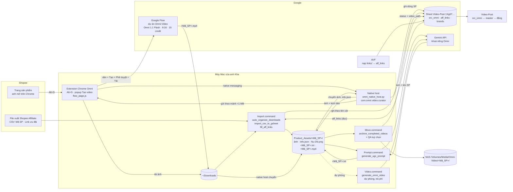

# Kiến trúc & bản đồ code — Omni-Video
Cập nhật 16/10/2026 (Thực thi – Omni-Video). Đổi cấu trúc thì sửa file này, cả sơ đồ, trong cùng commit. Luật làm việc + quy trình hằng ngày: `CLAUDE.md`. Hướng dẫn dùng: `README.md`.

## Sơ đồ tổng thể

## Chạy ở đâu
| Thành phần | Chạy ở | Anh làm |
|---|---|---|
| `chrome-extension/` (`content.js` Shopee, `flow_page.js` Flow, `background.js`, popup) | Chrome đã đăng nhập của anh | `Alt+S` trên Shopee; popup → **Tạo video** trên tab dự án Flow |
| `scripts/omni_native_host.py` | Mac, Chrome tự gọi qua native messaging (manifest trong `~/Library/Application Support/Google/Chrome/NativeMessagingHosts/com.omni.video.curator.json`) | Không bấm gì |
| `Import.command`, `Prompt.command`, `Move.command`, `Video.command` | Mac, Terminal, `venv/` | Nhấp đúp |
| Không có cron / LaunchAgent | — | Mọi bước chỉ chạy khi anh bấm |

## Đọc / ghi gì
| Nơi | Đọc | Ghi | Ai |
|---|---|---|---|
| Sheet `src_omni` (tên cũ `Omni-Video`; thiếu cả hai thì báo lỗi, không lấy tab khác) | ✔ | ✔ chỉ ô đổi, theo tên cột hàng 1 | `sheet_sync.py`, `import_csv_to_gsheet.py`, `fill_aff_links.py`, native host, Move |
| Sheet `aff_links` (AVF giữ) | ✔ | ✘ | `fill_aff_links.py` → `src_omni.shopee_link` (chỉ ô trống / chưa phải s.shopee.vn) |
| Sheet `brands` (AVF giữ) | ✔ `official_name` của `yenyen_deals` | ✘ | `determine_default_brand` |
| `~/Downloads` | ảnh Alt+S, CSV, video Flow `<Mã_SP>.mp4` | tên tải về | extension, native host, `auto_organize_downloads.py`, Move |
| `Product_Assets/<Mã_SP>/` (không commit) | ✔ | ✔ | mọi bước; Move xoá `info.json` + ảnh nhân vật rồi chuyển đi |
| `data/*.csv` (không commit) | CSV Shopee Affiliate đã nhập | ✔ | `import_csv_to_gsheet.py` |
| `config/prompt_rules.json` | luật chung nạp vào mọi kịch bản | ✘ | `generate_ugc_prompt.py` |
| `config/global_learned_rules.json` | — | bài học QA | `prompt_evolution_engine.py` (Move chế độ QA) |
| NAS `/Volumes/Media/Omni-Video/<Mã_SP>/` | — | ✔ | Move |

## Khoá & bí mật (chỉ tên, không ghi giá trị)
| Tên | Ở đâu | Dùng cho |
|---|---|---|
| `GEMINI_OMNI_API_KEY` (ưu tiên), `GEMINI_API_KEY` | `.env` (thắng `~/.zshrc`, chọn qua `scripts/omni_env.py`) | Sinh kịch bản, QA video, video API |
| `OMNI_SECURITY_PIN` | `.env` | PIN hỏi trước khi gọi video API trả phí |
| `config/service_account.json` | file, không commit | Google Sheets API v4 + Drive API v3 |
| Đăng nhập Google Flow / Shopee | Chrome của anh | Extension dùng phiên sẵn có, không lưu mật khẩu |

## Nối với project khác
- **Video-Post:** đọc `src_omni` (`job_id`, `title`, `video_path`, `shopee_link`, `brand_fb/yt/ig/tt`, `product_code`) → chép sang `master` → đăng. Không đổi tên tab / cột này khi chưa báo Video-Post.
- **Auto-Video-Factory:** giữ tab `brands` và `aff_links` (nạp file Shopee trong `links/`); Omni chỉ đọc.
- **Website giayhainancy.vn:** gián tiếp qua `product_code` (Video-Post đẩy lên web); Omni không gọi web.

## Chỗ hay nhầm
- Extension chỉ đổi tên + chuyển video khi bấm **Tạo video** từ popup; tải tay từ Flow thì phải tự đặt tên `<Mã_SP>.mp4`.
- Thư mục SP đã có `.mp4` (kể cả video lỗi) thì không hiện trong popup và Move sẽ chuyển nó lên NAS — xoá / đổi tên video lỗi trước.
- Flow có ảnh trong khung trò chuyện từ phiên cũ; extension chỉ nhận nút Phê duyệt / video mới sau khi bấm Tạo. Ô câu lệnh phải trống trước khi bấm.
- Kịch bản ghi Input Image 1 = sản phẩm, 2 = người mẫu: thứ tự dán ảnh phải giữ đúng (đã làm trong `flow_helper.encode_flow_files`).
- Sửa code extension xong phải **Reload** ở `chrome://extensions` và tải lại trang Flow.
