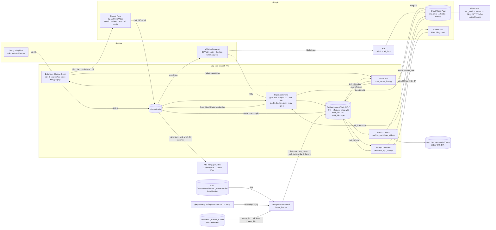

# Kiến trúc & quy trình — Omni-Video
Cập nhật 30/10/2026 (Thực thi · Video AI). **Nguồn duy nhất** tả quy trình / kiến trúc: đổi cấu trúc thì sửa file này (cả sơ đồ) trong cùng commit. Luật: `CLAUDE.md`. Cài đặt: `README.md`.

## Sơ đồ tổng thể

## Quy trình hằng ngày (anh bấm)
| Bước | Anh làm | Script | Kết quả |
|---|---|---|---|
| 0 | `Alt+S` trên trang SP Shopee | `content.js` → `omni_native_host.py` → `sheet_sync.py` | Ảnh + `info.json` vào `Product_Assets/<Mã_SP>/`; dòng `src_omni` (giá / lượt bán / shop đọc theo chữ trên trang); bấm lại không đổi status |
| 1 | `Import.command` | `auto_organize_downloads` → `import_csv_to_gsheet --all-new` → `fill_aff_links --apply` → `make_batch_links` → `season --apply` → `rank_products` | Gom ảnh; nhập mọi CSV Shopee Affiliate chưa nhập (sổ `data/.imported_csv.json`; file đã nhập không nhập lại → dòng anh xoá tay không quay lại); điền `shopee_link` (+ giá / % hoa hồng / shop ô trống) từ `aff_links`; còn dòng thiếu link thì tạo `~/Downloads/Omni_BatchCustomLinks_<giờ>.xlsx` (Sub_id1 = job_id) để anh tải lên Shopee Affiliate, file kết quả thả `~/agent_mailbox/auto-video-factory/affiliate/links/`; gắn mùa / "Hết mùa" (> 10 dòng thì dừng hỏi); in gợi ý SP theo hoa hồng (đ) × lượt bán |
| 2 | `Prompt.command` | `generate_ugc_prompt.py` | `<Mã_SP>.txt` + ảnh nhân vật (1 lượt Gemini / SP) |
| 2b | `python scripts/make_variants.py <Mã_SP> --count 3` (khi cần) | `make_variants.py` | Thư mục + dòng `src_omni` `<Mã_SP>-2`, `-3`, kịch bản khác góc |
| 3 | Mở dự án Flow (ô câu lệnh trống) → extension → **Tạo video** | `flow_page.js` + `flow_helper.py` | Dán ảnh (1 = SP lớn nhất, 2 = người mẫu, 3.. = SP còn lại, ≤ 7) + kịch bản → Tạo → Phê duyệt → chờ → Tải 720p `<Mã_SP>.mp4` (Chrome hỏi Save thì bấm Save) → vào `Product_Assets/<Mã_SP>/` |
| 4 | `Move.command` | `archive_completed_videos.py` + `contact_sheet.py` | Mỗi video mở tờ ảnh 10 khung `<Mã_SP>_xem.jpg` (ffmpeg, 0 Gemini): Enter = Move, `b` = bỏ qua (xoá tờ ảnh, thư mục giữ nguyên để làm lại). Move: xoá `info.json` + ảnh nhân vật, chuyển thư mục về NAS, Sheet "Đã tạo Video" + `video_path` |

### Hàng tiệm (Hiệu giày Hải Nancy, từ 30/10)
| Bước | Anh làm | Script | Kết quả |
|---|---|---|---|
| H1 | `HangTiem.command` → gõ mã (vd `JH8918N 32837D`) | `hang_tiem.py` | `Product_Assets/<mã>/`: ảnh theo thứ tự NAS `HNC_Master/<mã>/` (chỉ ảnh) → web `giayhainancy.vn/img/<mã>/<n>-1000.webp` (n = 1, 2… tới 404, đổi sang JPG) → `image_01…` SANPHAM; `info.json` (`hang_tiem: true`, tên / màu / chất liệu / đế / giới tính từ SANPHAM, tiêu đề hàng 2). Kịch bản `<mã>.txt` **ghép bằng code từ mẫu `config/hang_tiem.json`, 0 Gemini** Hai kiểu: **4 cảnh** (mặc định: phố lát đá sương sớm, mọi cảnh từ gối trở xuống, cận mũi, lật đế, kết ở cận giày; chép mọi chi tiết theo ảnh; loại giày lấy theo tên SP, "xỏ chân" / "lười" / "mọi" → slip-on loafers; bảng `dich` đổi màu / chất liệu sang tiếng Anh) + ảnh người mẫu Nam- / Nu- theo giới tính; **liền** (gõ `2` / `--lien`, thử 30/10: 1 cảnh 10 giây không cắt, mở ở cận giày rồi máy lùi dần ra người mẫu bước đi; dán tối đa 6 ảnh giày đủ góc theo thứ tự nhìn thẳng (khung rộng/cao < 1,1) → chéo 3/4 (rộng/cao 1,3–1,9, ít đặc nhất) → góc khác theo số → đế (ảnh số cuối); thừa thì bỏ ảnh góc gần trùng — rồi ảnh người mẫu cắt từ thắt lưng trở lên `<tên>_tren.jpg`, không lộ giày người mẫu). Không lời, không nhép môi. Mã không có ảnh → báo, bỏ qua. **Không tạo dòng `src_omni`**. (`Prompt.command` gặp thư mục hàng tiệm cũng ghép lại từ mẫu, không gọi Gemini) |
| H3 | Flow → extension → **Tạo video** | như bước 3 | Video **để nguyên** `~/Downloads/<mã>.mp4` (ghi `da_tai` vào info.json, mã biến khỏi popup) → Kho hàng gom vào SANPHAM → Video-Post |
| — | (tự động) | `hang_tiem.cleanup` (chạy đầu `HangTiem.command` và `Move.command`) | Video đã rời Downloads → xoá `Product_Assets/<mã>/`. Move bỏ qua thư mục hàng tiệm (không lên NAS Omni, không quét Downloads theo mã) |

Không có cron / LaunchAgent / n8n của Omni — mọi bước chỉ chạy khi anh bấm.

## Đọc / ghi gì
| Nơi | Đọc | Ghi | Ai |
|---|---|---|---|
| Sheet `src_omni` | ✔ | ✔ chỉ ô đổi, theo tên cột | `sheet_sync`, `import_csv_to_gsheet`, `fill_aff_links`, `season`, native host, Move |
| Sheet `aff_links` (AVF giữ; khoá aff_id + sub_id) | ✔ | ✘ | `fill_aff_links`: Sub_id = job_id → link gốc → link Sub_id = itemId |
| Sheet `brands` (AVF giữ) | ✔ `official_name` của `yenyen_deals` | ✘ | `determine_default_brand` |
| `~/Downloads` | ảnh Alt+S, CSV, video Flow | file Custom Link, tên video tải về | extension, native host, Import, Move |
| `Product_Assets/<Mã_SP>/` (không commit) | ✔ | ✔ | mọi bước |
| `config/prompt_rules.json`, `config/mua_vu.json`, `config/templates/` | ✔ | ✘ | kịch bản, lịch mùa, mẫu file Shopee |
| NAS `/Volumes/Media/Omni-Video/<Mã_SP>/` | — | ✔ | Move |
| NAS `/Volumes/Media/HNC_Master/<mã>/` | ✔ chỉ ảnh | ✘ | `hang_tiem.py` |
| Sheet HNC_Control_Center tab `SANPHAM` (Kho hàng giữ; tiêu đề hàng 2) | ✔ theo tên cột | ✘ | `hang_tiem.py` |
| `config/hang_tiem.json` | ✔ | ✘ | lời dặn kịch bản hàng tiệm |

### Cột `src_omni` Omni quản lý
`job_id` (item id Shopee, bản kịch bản thêm `<id>-N`), `title`, `price`, `sales_count`, `shop_name`, `commission_rate`, `commission`, `product_url`, `shopee_link`, `cdn_url`, `local_path`, `status` ("Đã chọn ảnh" → "Đã tạo Prompt" → "Đã tạo Video"; "Hết mùa"), `video_path`, `brand_fb/yt/ig/tt/shopee/zalo`, `season`.
**`product_code`: Omni không điền** (video YenYen Deals là hàng Shopee tiếp thị, không phải mẫu Hiệu giày Hải Nancy); không ghi đè ô đã có.

## Khoá & bí mật (chỉ tên)
| Tên | Ở đâu | Dùng cho |
|---|---|---|
| `GEMINI_OMNI_API_KEY` (ưu tiên), `GEMINI_API_KEY` | `.env` (thắng `~/.zshrc`, qua `scripts/omni_env.py`), gửi header `x-goog-api-key` | Sinh kịch bản |
| `config/service_account.json` | file, không commit | Google Sheets API v4 |
| Đăng nhập Google Flow / Shopee | Chrome của anh | Extension dùng phiên sẵn có |

## Nối với project khác
- **Video-Post:** đọc `src_omni` (`job_id`, `title`, `video_path`, `shopee_link`, `brand_*`, `product_code`) → `master` → đăng; bỏ qua status "Hết mùa"; chặn kênh Shopee cho mọi dòng `src_omni`. Đổi tên tab / cột phải báo Video-Post.
- **Auto-Video-Factory:** giữ tab `brands`, `aff_links` (nạp file Shopee trong `links/`, có Sub_id = job_id Omni).

## Chỗ hay nhầm
- Extension chỉ đổi tên + chuyển video khi bấm **Tạo video** từ popup; tải tay từ Flow thì tự đặt tên `<Mã_SP>.mp4`.
- Thư mục SP đã có `.mp4` (kể cả video lỗi) thì không hiện trong popup và Move sẽ chuyển nó lên NAS — xoá / đổi tên video lỗi trước.
- Ô câu lệnh Flow phải trống trước khi bấm; Flow giữ nút / video của phiên cũ, extension chỉ nhận cái mới sau khi bấm Tạo.
- Sửa code extension xong phải **Reload** ở `chrome://extensions` và tải lại trang Flow.
- Phần đã lưu trữ (video API, QA Gemini, Spark Drive): `archive/README.md`.
